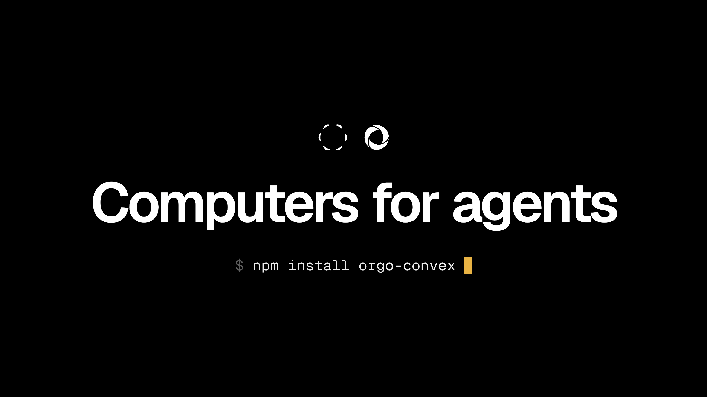

# Orgo for Convex



[](https://www.npmjs.com/package/orgo-convex)

<!-- START: Include on https://convex.dev/components -->

Give your agents a computer. Each [Orgo](https://www.orgo.ai) computer is an isolated virtual
machine with a full Linux or Windows desktop, a browser, a terminal and a disk that persists. This
component drives them from your Convex actions and keeps every computer and every run in reactive
tables your UI can subscribe to.

```ts
// convex/agent.ts
import { Orgo } from "orgo-convex";
import { v } from "convex/values";
import { components } from "./_generated/api";
import { action } from "./_generated/server";

const orgo = new Orgo(components.orgo);

export const analyze = action({
  args: { code: v.string() },
  handler: async (ctx, args) => {
    const userKey = (await ctx.auth.getUserIdentity())?.tokenIdentifier;
    if (!userKey) throw new Error("Sign in first");
    const computer = await orgo.createComputer(ctx, {
      workspaceId: process.env.ORGO_WORKSPACE_ID!,
      name: "analysis",
      userKey,
    });
    return await orgo.runPython(ctx, { computerId: computer.computerId, userKey, code: args.code });
  },
});
```

- **Computers.** Create, start, stop and delete. Stopping keeps the disk.
- **Commands and Python.** Output, exit codes, timeouts and a full run history.
- **Screenshots.** The screen as PNG bytes, ready for computer-use models.
- **Files.** Upload and export, up to 10 MiB each.
- **Live state.** Show "running…", exit codes and history from queries instead of polling.
- **Safe by default.** Each computer belongs to a `userKey` your server derives from the signed-in
  user, checked before anything reaches Orgo. Passwords, tokens and signed links Orgo returns never
  reach a table, a return value or an error. Deleting is off until you turn it on.
- **No dependencies.** Plain `fetch` in Convex's default runtime: no SDK, no `"use node"`.

<!-- END: Include on https://convex.dev/components -->

## Installation

```bash
npm install orgo-convex
```

Create an API key at [orgo.ai/settings/credentials](https://www.orgo.ai/settings/credentials) (API
keys → New key; a key scoped to one workspace is enough) and set it on your deployment, with the
workspace your computers should live in (`GET https://www.orgo.ai/api/workspaces` lists your
workspaces and their ids):

```bash
npx convex env set ORGO_API_KEY sk_live_...
npx convex env set ORGO_WORKSPACE_ID <workspace id>   # read by your own code, as above
```

Components cannot read your app's environment variables, so pass the key down in
`convex/convex.config.ts`:

```ts
// convex/convex.config.ts
import { defineApp } from "convex/server";
import { v } from "convex/values";
import orgo from "orgo-convex/convex.config.js";

const app = defineApp({
  env: { ORGO_API_KEY: v.string(), ORGO_API_URL: v.optional(v.string()) },
});
app.use(orgo, {
  env: { ORGO_API_KEY: app.env.ORGO_API_KEY, ORGO_API_URL: app.env.ORGO_API_URL },
});
export default app;
```

The key is passed by reference, so rotating it needs no redeploy, and it never travels in function
arguments. `ORGO_API_URL` is optional: an origin such as `https://www.orgo.ai` (the default),
without `/api`. You can install the component under another name with
`app.use(orgo, { name: "computers", env })` and pass `components.computers` to the client.

Requires `convex` 1.43 or later.

## Usage

```ts
import { Orgo } from "orgo-convex";
import { components } from "./_generated/api";

const orgo = new Orgo(components.orgo);
// Options: new Orgo(components.orgo, { allowDelete: true, retainOutput: true })
```

Methods that call Orgo take an action ctx. `getComputer`, `listComputers`, `getExecution` and
`listExecutions` read the component's tables, work in queries, and update live.

### Authorization: `userKey`

Pass the same `userKey` to every call about a computer: create it with one, and every later read or
action must present the same one or it is treated as not found, before any request reaches Orgo.
Derive it on the server from the signed-in user (for example `identity.tokenIdentifier`), never from
client input. Computers created without a `userKey` can only be reached without one, which suits a
single-tenant backend.

The component only manages computers it created. Computers made elsewhere in your Orgo workspace are
not listed and cannot be driven through it.

### Computers

```ts
const computer = await orgo.createComputer(ctx, {
  workspaceId, // required: the Orgo workspace
  name: "agent-1", // required, 1-80 characters
  os: "linux", // or "windows"; optional: cpu, ram (GB), diskSizeGb, resolution, templateRef
  userKey,
});
// → { computerId, workspaceId, name, os, status: "running", userKey, remoteCreatedAt, observedAt }

await orgo.getComputer(ctx, { computerId, userKey }); // last observed state, or null
await orgo.listComputers(ctx, { userKey, limit: 50 }); // live computers, newest first (max 200)
await orgo.refreshComputer(ctx, { computerId, userKey }); // re-read from Orgo; null once it is gone
```

`status` is what Orgo last reported: `running`, `frozen` (stopped, disk kept), `suspended`,
`creating`, `error`, `deleted` and a few transitional values. The table holds the last
_observation_, with `observedAt`; it does not poll Orgo on its own. Call `refreshComputer` to look
again.

### Starting and stopping

```ts
const res = await orgo.stopComputer(ctx, { computerId, userKey, waitSeconds: 120 });
// → { computer, pending: false, operation: { status: "succeeded", ... } }  computer.status: "frozen"
await orgo.startComputer(ctx, { computerId, userKey });
```

Orgo runs these as operations. The component waits up to `waitSeconds` (0-300, default 120). If Orgo
is still working when the wait ends, it returns `pending: true` with the operation; the computer's
`status` stays at its last observation until Orgo confirms. `refreshComputer` later reads that
operation's outcome without sending another start or stop. A failed operation throws with Orgo's
reason. Stopping is not offered for every operating system; Orgo refuses those.

### Deleting

```ts
const orgo = new Orgo(components.orgo, { allowDelete: true });
await orgo.deleteComputer(ctx, { computerId, userKey }); // → { deleted: true }
```

Without `allowDelete: true` this throws `delete_not_allowed` before any request. That protects
against stray calls; it is not a security boundary. The row stays as a tombstone
(`status: "deleted"`, `deletedAt`) and leaves `listComputers`.

### Commands and Python

```ts
const run = await orgo.runCommand(ctx, {
  computerId,
  userKey,
  command: "ls -la /tmp",
  timeoutSeconds: 60,
});
// → { executionId, status: "succeeded", exitCode: 0, output: "...", outputTruncated: false, durationMs: 214 }

const py = await orgo.runPython(ctx, { computerId, userKey, code: "print(6 * 7)" });
// → { status: "succeeded", output: "42\n", ... }
```

- `command` runs in bash on Linux and PowerShell on Windows. `code` runs in a fresh `python3 -c`.
- `timeoutSeconds`: 1-300 (Orgo's ceiling), default 60. The call returns when the run ends.
- `status` is `succeeded`, `failed` (nonzero exit; `exitCode` says which) or `timed_out`. A failing
  command resolves; it does not throw.
- `output` is stdout and stderr combined, as Orgo returns them. On Linux, Python reports success or
  failure but no exit code, so `exitCode` is absent there.
- Windows says when a run timed out. Linux does not (bash answers exit code -1, Python answers
  failure), so on Linux a run is `timed_out` only if it also lasted the full `timeoutSeconds`.
- The call throws when Orgo refuses the request (the row says `error`: nothing ran) or when the
  response is lost or does not say how the run ended (the row says `unknown`: it may have run). It
  is never retried for you, because a retry could run the command twice.

Every run is recorded:

```ts
await orgo.listExecutions(ctx, { computerId, userKey, limit: 20 }); // newest first, at most 100
await orgo.getExecution(ctx, { executionId, userKey });
```

Rows hold metadata only (status, exit code, timing): commands and output can carry secrets. With
`new Orgo(components.orgo, { retainOutput: true })` a row also keeps the command (first 4 KB of
UTF-8) and the output (first 64 KB of UTF-8). Truncation is not redaction.

`purgeExecutions` is maintenance for your operators, not a per-user action: it deletes **every**
owner's runs older than a cutoff, 100 per call, and keeps runs still in progress. Call it from an
internal function or a cron, never from a function your users can call:

```ts
// convex/crons.ts
crons.interval("clear old runs", { hours: 1 }, internal.maintenance.clearRuns, {});

// convex/maintenance.ts
export const clearRuns = internalMutation({
  args: {},
  handler: async (ctx) => {
    const { hasMore } = await orgo.purgeExecutions(ctx, { olderThanMs: 7 * 24 * 3600 * 1000 });
    if (hasMore) await ctx.scheduler.runAfter(0, internal.maintenance.clearRuns, {});
  },
});
```

### Screenshots

```ts
const shot = await orgo.screenshot(ctx, { computerId, userKey });
// → { bytes: ArrayBuffer, mimeType: "image/png", width: 1280, height: 720 }
const storageId = await ctx.storage.store(new Blob([shot.bytes], { type: shot.mimeType }));
```

### Files

```ts
await orgo.uploadFile(ctx, { computerId, userKey, path: "/tmp/data.csv", content: csvText });
// content: string (written as UTF-8), ArrayBuffer or Uint8Array; missing folders are created on Linux

const file = await orgo.exportFile(ctx, { computerId, userKey, path: "/tmp/report.pdf" });
// → { bytes: ArrayBuffer, sizeBytes, contentType, filename: "report.pdf" }
const text = new TextDecoder().decode(file.bytes);
```

Paths are absolute: `/home/user/x.txt` on Linux, `C:\Users\Public\x.txt` on Windows. An export
writes a copy to Orgo's workspace storage; the component downloads it and then deletes that copy.
The cleanup is best effort: if it fails, the copy stays in the workspace's Files list.

### Errors

Errors from the component carry structured data that survives the component boundary:

```ts
import { orgoErrorData } from "orgo-convex";

try {
  await orgo.stopComputer(ctx, { computerId, userKey });
} catch (e) {
  const err = orgoErrorData(e); // null if it is not an Orgo error
  if (err?.code === "conflict") console.log(err.message, err.orgoCode); // e.g. "not_stoppable"
}
```

`code` is one of `config`, `invalid_argument`, `not_found`, `delete_not_allowed`, `bad_request`,
`unauthorized`, `payment_required`, `forbidden`, `conflict`, `too_large`, `unprocessable`,
`rate_limited`, `not_implemented`, `server_error`, `unavailable`, `timeout`, `network`,
`invalid_response`. `status` is Orgo's HTTP status when it answered, `retryAfterSeconds` its retry
hint. Messages are Orgo's own short text with URLs and keys removed; raw responses are never
included.

## Limits

|                                 | Limit                                                                             |
| ------------------------------- | --------------------------------------------------------------------------------- |
| Command or Python timeout       | 1-300 s (Orgo's ceiling)                                                          |
| Command or code length          | 100,000 characters                                                                |
| Output returned                 | 4M characters (flagged `outputTruncated`); Orgo's response capped at 8 MiB        |
| Output kept with `retainOutput` | first 64 KB of UTF-8; command first 4 KB                                          |
| Upload                          | 10 MiB (Orgo's direct upload limit)                                               |
| Export                          | `maxBytes`, default 10 MiB, at most 12 MiB (Convex returns are limited to 16 MiB) |
| Screenshot                      | 10 MiB                                                                            |
| Start/stop wait                 | 0-300 s                                                                           |
| Lists                           | computers 200 rows, executions 100 rows per call                                  |

Every Orgo request has its own deadline (create 5 min, commands their timeout plus 45 s, files 150
s) so an action stays well inside Convex's action time limit.

Actions and Orgo are not one transaction. If a create's answer is lost, the computer may exist in
your workspace without a row; the error says so and the component never creates it again on its own.
Check the workspace before retrying.

Not in this version: background commands, webhooks, mouse and keyboard control, public URLs, billing
and workspace management. Use Orgo's API or SDK for those.

## Testing

Register the component in [convex-test](https://docs.convex.dev/testing/convex-test):

```ts
import { convexTest } from "convex-test";
import orgoTest from "orgo-convex/test";
import schema from "./schema";

const modules = import.meta.glob("./**/*.ts");
const t = convexTest(schema, modules);
orgoTest.register(t); // or orgoTest.register(t, "computers") for another name
```

Calls to Orgo use the global `fetch`, so stub it in tests (for example with `vi.stubGlobal`).

## Demo

`example/` is a small app that drives one computer with fixed commands, safe to put on a public
link: visitors cannot run their own code or create, stop or delete anything; actions are spaced
three seconds apart and capped at 300 a day across all visitors; `npx convex run demo:pause` stops
them; run history older than a day is cleared hourly. To run it locally from a clone of this
repository:

```bash
npm install
npx convex init                                  # choose or create a dev deployment
npx convex env set ORGO_API_KEY sk_live_...      # before the first deploy: the app requires it
npm run dev                                      # backend; keeps watching
# in a second terminal:
npx convex run demo:setup '{"workspaceId":"<workspace id>"}'
npm run dev:frontend                             # the page, at the address Vite prints
```

`npx convex run demo:teardown` deletes the demo computer. Without a Convex account, run the init as
`CONVEX_AGENT_MODE=anonymous npx convex init` to use a local deployment.

## Maintenance and security

Maintained by Orgo. Report security problems privately through this repository's Security tab
(Report a vulnerability), not in a public issue. See [CHANGELOG.md](./CHANGELOG.md) for releases.

## License

MIT for the component. The project scaffolding came from Convex's component template under
Apache-2.0; see [THIRD_PARTY_NOTICES.md](./THIRD_PARTY_NOTICES.md).
